# Muro de mensajes

**Equipo: 3**
**Proyecto de Google Cloud: project-ded4209f-94f1-47b0-a63**
**URL del muro:** [https://perez-frontend-7ur5qm2g3a-uc.a.run.app/](https://perez-frontend-7ur5qm2g3a-uc.a.run.app/)

## Diagrama

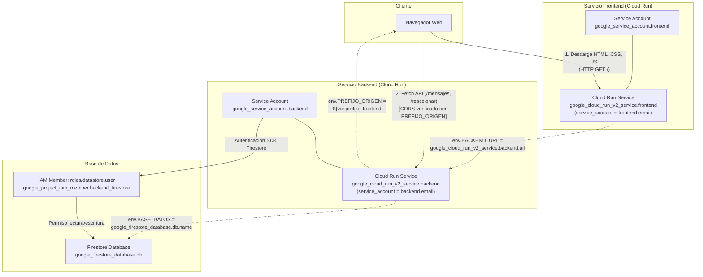

## Fase 0. Preparación

Se contaba con las utilidades instaladas para terraform y docker, y se procedió a instalar `hey`. 

Output en texto de los comandos de evidencia:

```bash
$ terraform --version && docker --version && gcloud config list
Terraform v1.16.2

{texto de actualizar terraform}

on linux_amd64
Docker version 29.8.2, build 7fc2dff
[accessibility]
screen_reader = True
[component_manager]
disable_update_check = True
[compute]
gce_metadata_read_timeout_sec = 30
[core]
account = anorakteam@gmail.com
disable_usage_reporting = False
project = project-ded4209f-94f1-47b0-a63
universe_domain = googleapis.com
[metrics]
environment = devshell
```

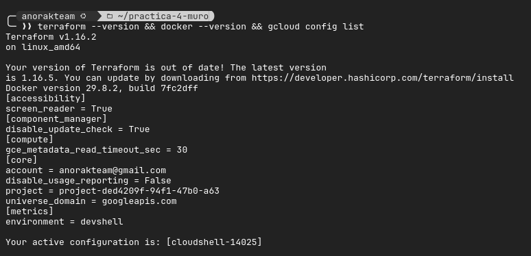

## Fase 1. Las imágenes

Se muestra la página generada, sin poder comunicarse con el backend:

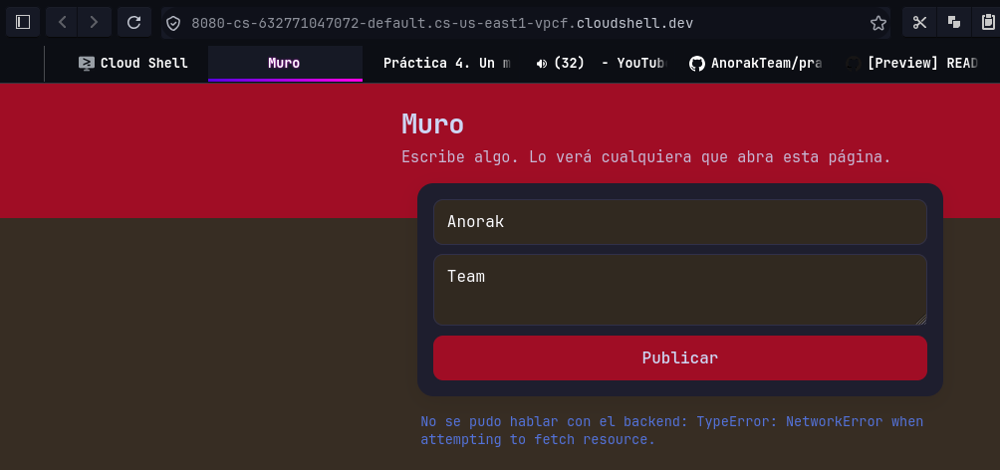

Y el backend reconstruido luego de cambiar una palabra del comentario:

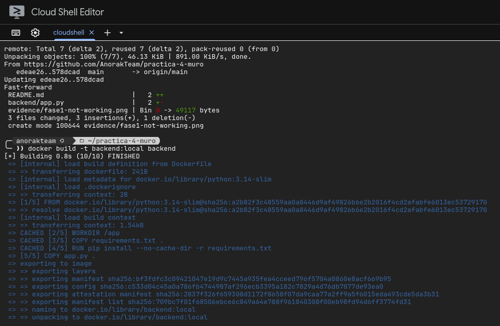

## Fase 2. Los cimientos

> NOTA IMPORTANTE: Dentro del entorno de cloud shell, por alguna razón, no permitía a Docker pushear las imágenes al artifact registry, así que se habilitó y utilizó el servicio de cloud build para subir esas imágenes.

Las imágenes se subieron al registro luego de ser construidas:

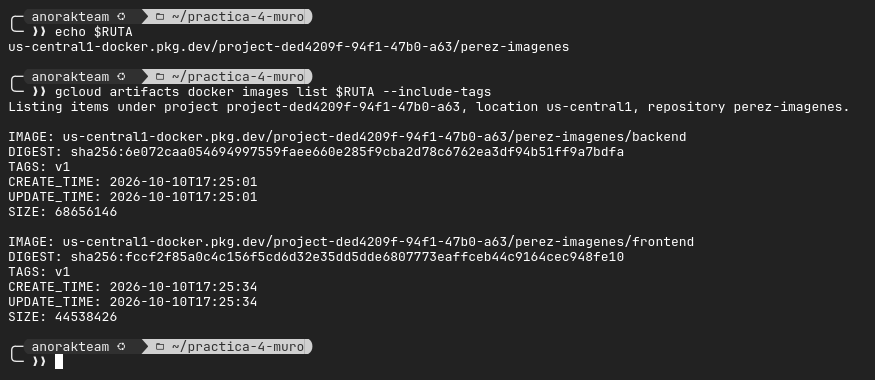

Luego, se listó con gcloud directamente las bases de datos de firestore existentes:

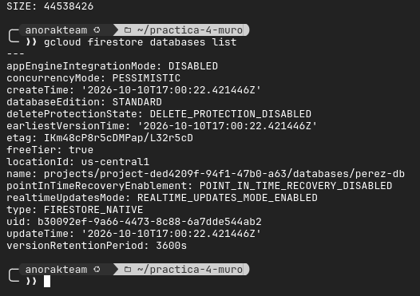

Y por último, la cuenta del backend con los permisos de user para lectura y escritura en firestore:

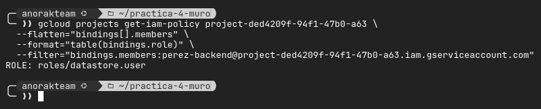

## Fase 3. El backend

Luego de la ejecución de los pasos para integrar el recurso de cloud run, e instanciar estos, se ejecutaron los comandos curl para crear las entradas:

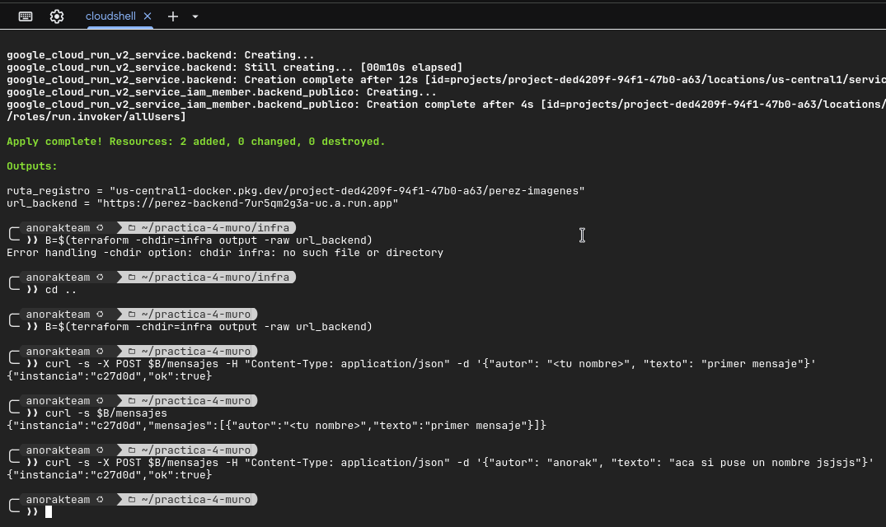

Y los registros se crearon exitosamente:

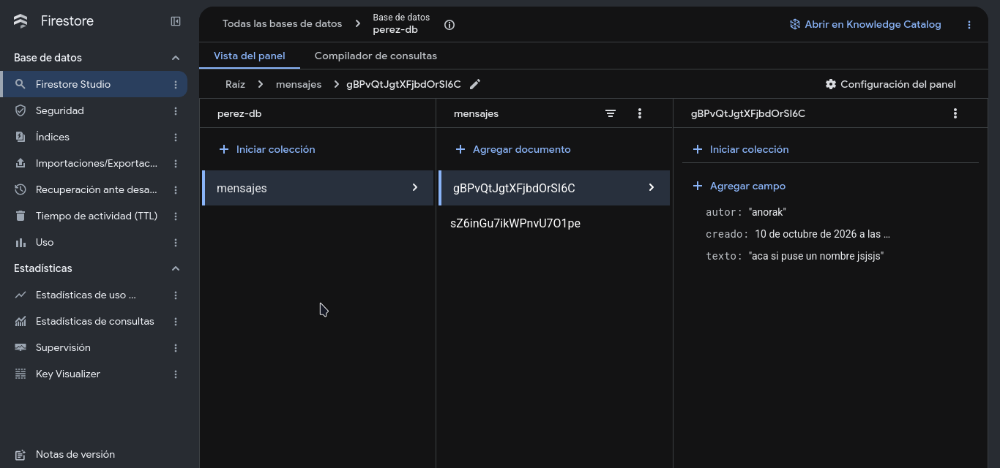

## Fase 4. El frontend, conectado

A continuación, el resultado de ejecutar los pasos de la fase 4 hasta lanzar la app y obtener la uri con la cual se compartió y se accedió al recurso del frontend:

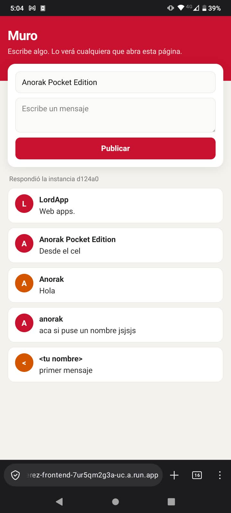

## Fase 5. El estado vive afuera

Se ejecutaron en las dos pestañas los comandos para poner presión a la uri del backend, y se obtuvieron estos resultados:

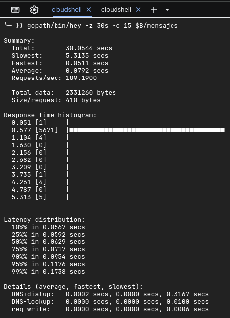

Y las métricas desde el dashboard de gcp para el backend:

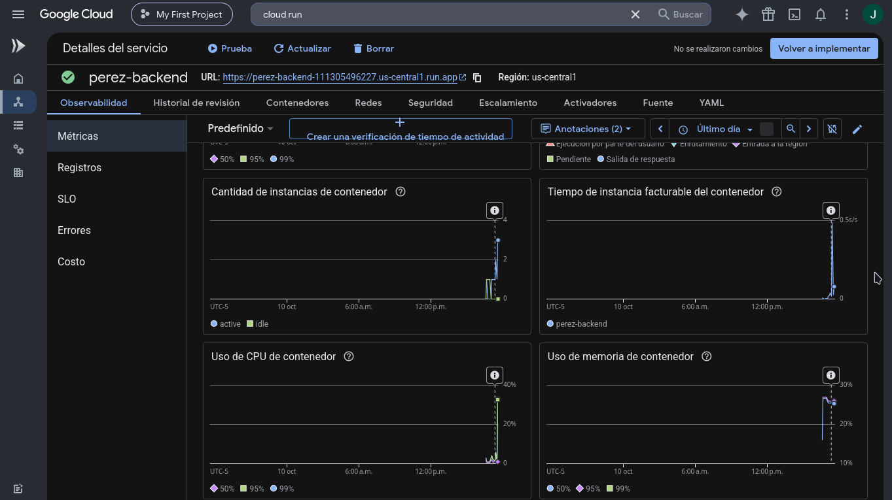

## Fase 6. Reto: Hacerlo tuyo (v2)

### Decisiones y justificaciones del reto

**1. Funcionalidad nueva (Reacciones en v2)**
- **Firestore:** Se agregó el campo `reacciones` (mapa de emojis y conteos) por mensaje, actualizado atómicamente con `firestore.Increment(1)`.
- **Backend:** Se creó el endpoint `POST /mensajes/<id>/reaccionar` y se adaptó `GET /mensajes` para exponer el ID y las reacciones.
- **Frontend:** Badges interactivos ordenados por votos y botón para agregar cualquier emoji desde el teclado.
- **Despliegue:** Imágenes compiladas como `:v2` y desplegadas actualizando las variables en `terraform.tfvars`.

**2. Romper el ciclo de CORS**
- **Solución:** Para evitar la dependencia circular en Terraform (el backend necesita la URL del frontend y el frontend la del backend), el backend recibe solo la variable `PREFIJO_ORIGEN = "${var.prefijo}-frontend"` y valida dinámicamente si el encabezado `Origin` de la petición proviene de un subdominio `.run.app` con ese prefijo.
- **Por qué funciona:** El grafo de Terraform es lineal (`backend -> frontend`) sin dependencias cíclicas.
- **Qué la haría fallar:** Migrar el frontend a un dominio personalizado sin actualizar la validación del backend.

**3. Bajar las lecturas de Firestore**
- **Qué se cambió:** Se eliminó el polling incondicional cada 5 segundos y se pasó a un modelo impulsado por acciones (solo refresca en la carga inicial, al publicar, al reaccionar o con el botón manual de actualizar que incluye un cooldown de 5 segundos).
- **Cuánto bajó:** En reposo bajó de 14.400 lecturas/hora a 0 lecturas/hora por pestaña (ahorro del 100%).
- **Qué se pierde:** La sincronización automática pasiva; si otro usuario publica un mensaje, no aparece hasta interactuar o pulsar el botón de actualizar.

**4. Reproducción completa desde cero**
- **El problema:** `terraform destroy` borra el Artifact Registry junto con las imágenes Docker, provocando que un `terraform apply` directo falle porque Cloud Run no encuentra las imágenes.
- **Orden de creación:**
  1. `terraform apply -target=google_artifact_registry_repository.imagenes` para aprovisionar únicamente el registro.
  2. Compilar y subir `backend:v2` y `frontend:v2` mediante Cloud Build.
  3. Esperar 5 minutos (tiempo que exige Google Cloud para poder recrear una base de datos en Firestore con el mismo nombre).
  4. `terraform apply` completo para levantar Cloud Run, IAM y Firestore.
- Se automatizó todo este flujo en el script ejecutable `reproducir.sh`.

---

### Medición de Lecturas de Firestore (Antes vs. Después)

| Parámetro | Antes (v1 con `setInterval(5000)`) | Después (v2 con eventos y cooldown) |
| :--- | :--- | :--- |
| **Frecuencia de refresco** | Cada 5 segundos de forma incondicional | Solo ante eventos (publicar / reaccionar) + botón manual con 5s de cooldown |
| **Peticiones/hora por pestaña en reposo** | 720 peticiones/hora | **0 peticiones/hora** (tras la carga inicial) |
| **Lecturas/hora de Firestore en reposo** | 720 * 20 = **14.400 lecturas/hora** | **0 lecturas/hora** |
| **Lecturas/hora con uso activo** *(10 acciones/h)* | ~14.400 lecturas/hora | 10 * 20 = **200 lecturas/hora** |
| **Consumo diario en reposo** | 345.600 lecturas/día (agota la cuota gratuita en 3.5 h) | 20 lecturas/día (solo la apertura inicial) |
| **Porcentaje de ahorro** | - | **100% en reposo / 98.6% en uso activo** |

---

### Evidencias

Para la funcionalidad nueva y el control de lecturas, se implementaron las reacciones a los mensajes con emojis y el botón de actualizar con cooldown de 5 segundos. Aquí se ve el muro en su versión v2 funcionando con las reacciones y votos:

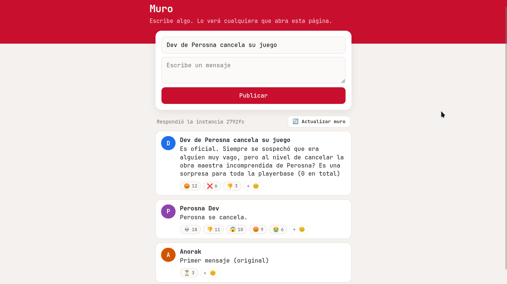

Para comprobar que el backend solo acepta peticiones desde el frontend propio, al intentar consultar la API desde la consola en otra pestaña o sitio, el navegador bloquea la lectura por CORS:

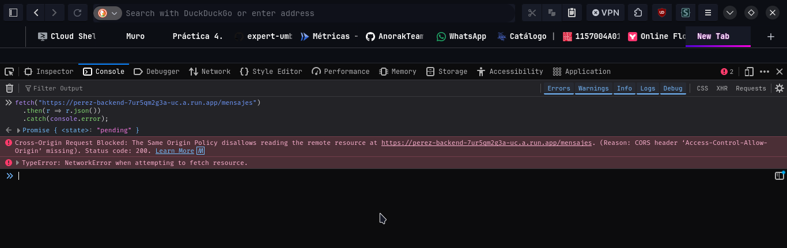

Para la prueba de destrucción y reproducción completa, primero se ejecutó `terraform destroy` para borrar toda la infraestructura:

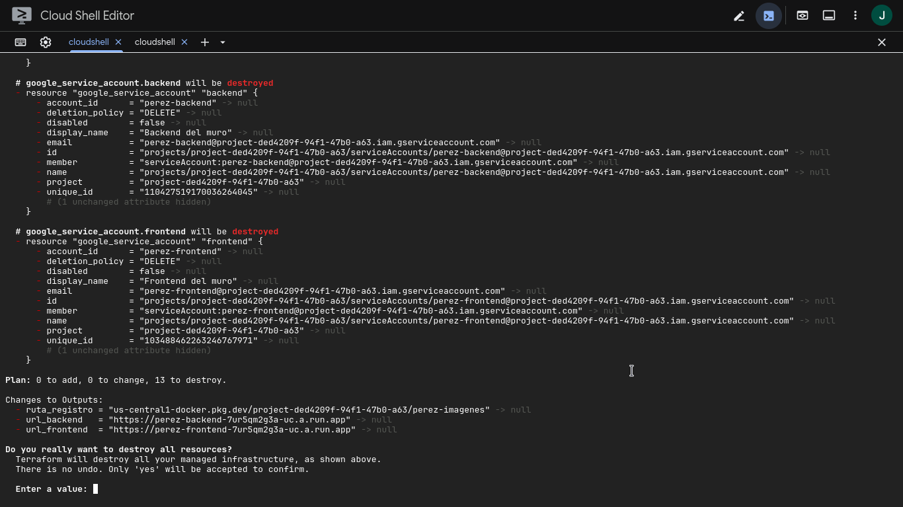

Y la confirmación de la destrucción total de los 13 recursos:

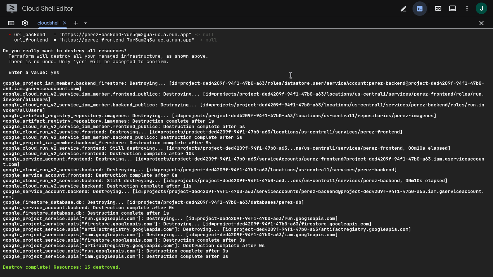

Luego, para volver a levantar todo sin fallar por las imágenes ni por el límite de tiempo que pide GCP para reutilizar el nombre de la base de datos de Firestore, se ejecutó el script `reproducir.sh`:

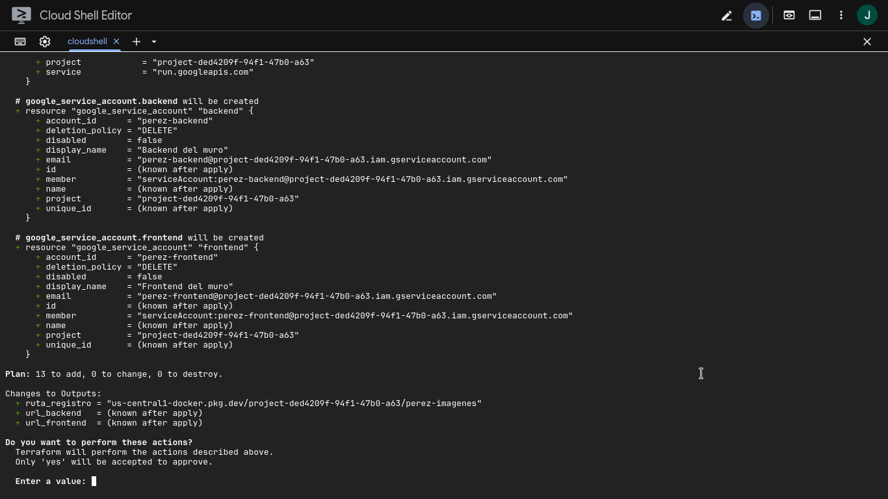

Y el resultado final con los servicios, base de datos e imágenes aprovisionados de nuevo y listados en el estado de Terraform:

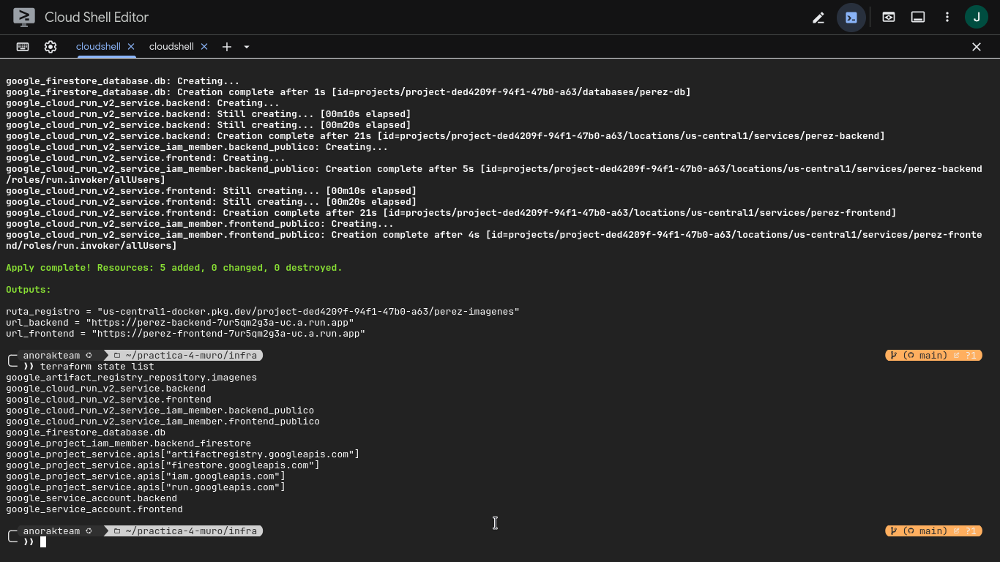

---

### Preguntas

**¿Por qué con curl la API funciona aunque falten las cabeceras de CORS, y desde la página no?**  
CORS es una restricción que solo aplican los navegadores web por seguridad para aislar sitios. Las herramientas como `curl` hacen peticiones HTTP directas y no ejecutan JavaScript ni evalúan orígenes, por lo que ignoran las cabeceras de CORS y reciben la respuesta sin bloqueos.

**Si le quitas el rol a la cuenta de servicio del backend, ¿qué deja de funcionar, y dónde encontrarías el error?**  
Dejan de funcionar la lectura y escritura de mensajes en Firestore (los endpoints `GET` y `POST` darán error 500, aunque el chequeo de salud `GET /` seguirá respondiendo 200). El error de permisos (403) se vería registrado en Cloud Logging.

**¿Cuánto cuesta tu muro un mes sin visitas, y cuánto si cien personas lo dejan abierto todo el día, antes y después de tu cambio del reto?**  
Sin visitas cuesta 0 USD porque Cloud Run escala a cero y los recursos pasivos entran en la cuota gratuita. Con 100 personas todo el día: antes costaba entre ~370 y ~620 USD al mes al generar más de 1.000 millones de lecturas por el refresco incondicional cada 5s. Después, cuesta la carga inicial de esas 100 páginas en sus navegadores, y luego 0 USD el resto del tiempo porque al eliminar el polling no se consumen lecturas en segundo plano.

---

## Comandos ejecutados por fase

Fase 0:
```bash
terraform --version && docker --version && gcloud config list
```

Fase 1:
```bash
docker build -t frontend:v1 frontend/
docker run -d -p 8080:8080 frontend:v1
docker build -t backend:v1 backend/
docker run -d -p 8081:8080 backend:v1
```

Fase 2:

> NOTA: nuevamente, como se mencionó en la fase, docker dió problemas (y el fix que está en la guía sobre ese caso en específico no funcionó), se utilizó cloud build para subir las imágenes al artifact registry.

```bash
gcloud builds submit backend --tag us-central1-docker.pkg.dev/project-ded4209f-94f1-47b0-a63/perez-imagenes/backend:v1
gcloud builds submit frontend --tag us-central1-docker.pkg.dev/project-ded4209f-94f1-47b0-a63/perez-imagenes/frontend:v1
gcloud firestore databases list
gcloud projects get-iam-policy project-ded4209f-94f1-47b0-a63 --flatten="bindings[].members" --format="table(bindings.role)" --filter="bindings.members:perez-backend"
```

Fase 3:
```bash
cd infra
terraform init
terraform apply
B=$(terraform output -raw url_backend)
curl -s -X POST $B/mensajes -H "Content-Type: application/json" -d '{"autor": "<tu nombre>", "texto": "primer mensaje"}'
curl -s -X POST $B/mensajes -H "Content-Type: application/json" -d '{"autor": "Anorak", "texto": "acá si puse un nombre jsjsjs"}'
curl -s $B/mensajes
```

Fase 4:
```bash
cd infra
terraform apply
terraform output url_frontend
# se pasó la url al cel y a alguien más para probarla, claramente
```

Fase 5:
```bash
B=$(terraform -chdir=infra output -raw url_backend)
# La guía tenía un error incluído en la sección de troubleshooting, y es que hey se instala en ~/gopath/bin/hey, tuve que hacer un 
# find ~ -type f -name "hey" -perm -111 2>/dev/null
# para saber donde estaba.
~/gopath/bin/hey -z 30s -c 15 $B/mensajes
# y en otra pestaña de terminal
B=$(terraform -chdir=infra output -raw url_backend)
for i in $(seq 15); do curl -s $B/mensajes | cut -c1-30; done
```

Fase 6:
```bash
chmod +x reproducir.sh
./reproducir.sh # el script que se subió luego de darse cuenta del problema con crear la misma bd de firestore con mismo nombre, se terminó por hacer un script para no tener que estar esperando los 300 segundos y que lo haga automáticamente por pasos el terraform apply
```
